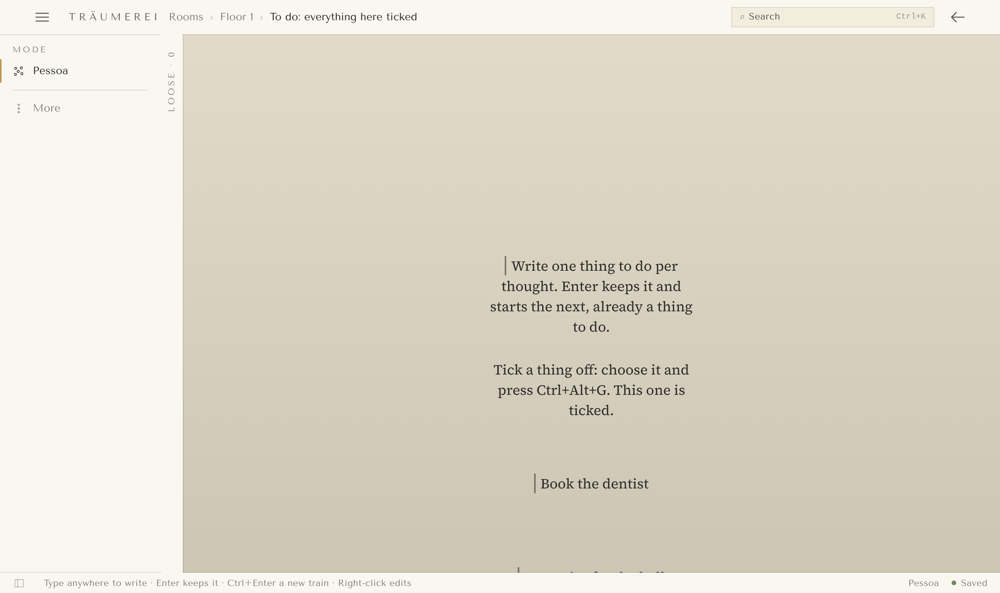
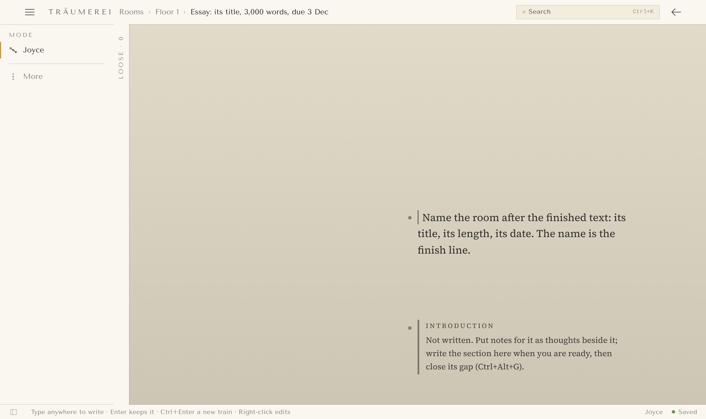
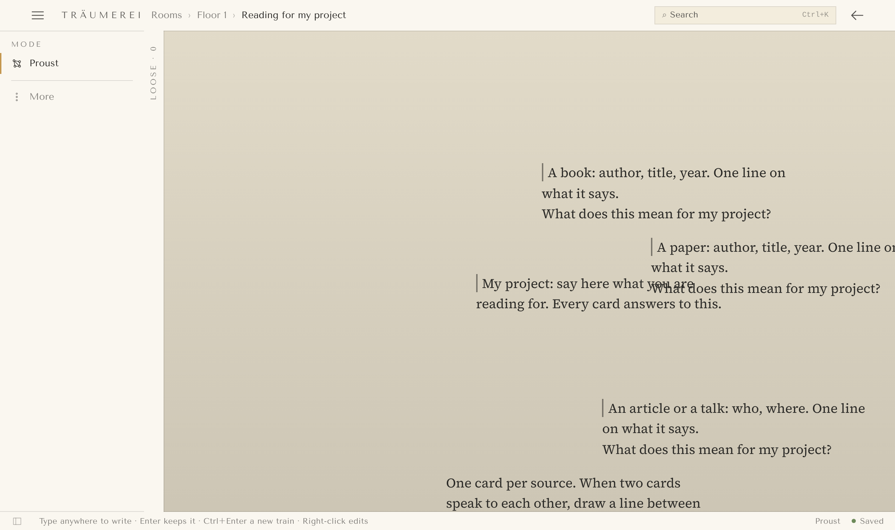
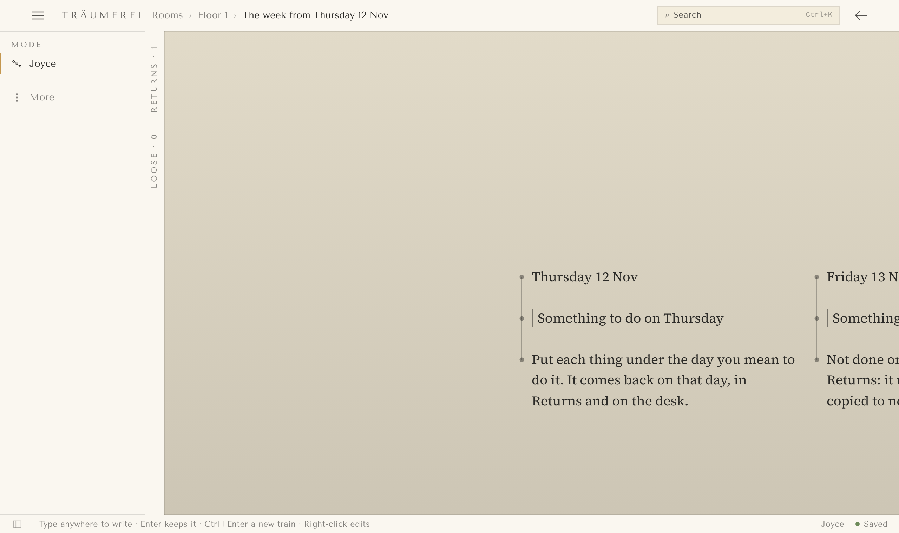

# Träumerei

Rooms for finishing things. Write what you think, mark what is still missing, and when a room has
nothing left open, you are done, and you know it, because the room knows it.

**[Download Träumerei for Windows](https://github.com/eleadlau-commits/Traumerei/releases/latest)**:
run the `…_x64-setup.exe` file from the latest Release. It isn't signed yet, so Windows shows
"Windows protected your PC": click **More info**, then **Run anyway**. Or use the
[web copy](https://eleadlau-commits.github.io/Traumerei/) in Chrome.

## Start from something familiar

The first time it opens, Träumerei offers four rooms in shapes you already know, and a sample
room. Each template runs out within the first hour, at the point where the familiar habit stops
being enough and Träumerei takes over. That point is the whole purpose of the template.

| | |
|---|---|
|  |  |
| **To-do list.** A plain list you tick: every item is a gap, and a tick closes it. It runs out when one thing waits on another; switch to Russell and see what blocks what. | **Essay or report.** Headings with notes under them, each heading "not written", in a room named after the finished text. It runs out when you want to know how much is left: the desk says, and Export gives you the text when nothing is open. |
|  |  |
| **Reading notes.** One card per book or paper, each asking "what does this mean for my project?". Closing those questions is the real reading. | **Weekly plan.** Seven days with things under each, each due on its day. Friday comes and things are not done: they roll on instead of being copied, and the same thing rolling three times is a question worth asking. |

A template is a door, not a room to live in. The **Sample room** walks through the first hour in
seven steps, five done and two left open for you to close.

## Why

Most of what we start, we do not finish. Not for lack of ideas, but because the mind cannot hold a
project still: it forgets what it decided, loses the thread, and cannot see from the inside how
much is left. Note apps are very good at collecting and very poor at ending. Träumerei starts from
the other end: not "where do I keep my notes" but "how does this get finished".

> A note is a mark made now, so that something the mind cannot hold still does its work later.

Everything in Träumerei is made of six things that definition names: a **mark** (the thought
itself), a **moment** (when), a **distance** (who it is for), a **place** (where it sits, and under
what rule), a **link** (what belongs with what) and a **gap** (what is still missing). There are no
note types: a to-do is a mark with a gap to do, a question is a mark with an open gap, a chapter is
marks in a tree written for others. A mark is done when its gap is closed, and a project is a room
that is finished when nothing in it is open.

## The first hour

1. **Make a room and name it after the result.** Not "History essay" but "Essay on 1848, 3,000
   words, due 28 Nov". The name is the finish line.
2. **Empty your head into it.** One thought at a time; Enter keeps a thought and starts the next.
   Do not sort.
3. **Mark what is missing** with a gap (Ctrl+Alt+G). The gaps are the whole to-do list.
4. **Give it a shape when the pile asks for one:** a tree (Russell) when things have parts, a web
   (Proust) when they relate, a flow (Joyce) for a text, loose (Pessoa) for no shape at all. The
   thoughts stay the same.
5. **Say when you will be back** (Ctrl+Alt+R): a date, or Tomorrow. Nothing nags before then.
6. **Work from the desk** (Ctrl+Alt+D): every open gap and every return, across all rooms. Close
   one gap a day.
7. **When the room has no open gaps, let it leave.** Export it; the room stays as the record.

The first hour is steps 1 to 3. Shapes, returns and the desk arrive in the first week, when the
pile asks for them.

| Key | Does |
|---|---|
| Enter | Keeps the thought and starts the next (Ctrl+Enter: a new line inside one) |
| Right-click | Adds a thought on empty canvas; edits the thought under the pointer |
| Ctrl+K | Finds anything, in this room or another, and can link to it |
| Ctrl+Alt+G | Marks a gap on the chosen thought, or closes it |
| Ctrl+Alt+R | Sets a return on it |
| Ctrl+Alt+D | Opens the desk |
| Ctrl+G, Ctrl+F | Groups chosen thoughts; folds a group |

## For developers

Träumerei is built with **Folio**.
Every pull request runs **Check pull request** (`.github/workflows/check.yml`): all the tests
(`python build.py test`), then a build of the one-file page, then the speed budgets on it
(`node tests/speed.mjs`: a 1,500-thought room opens in 0.8 s, starting a thought and Enter each
show in 0.35 s, a key typed into a thought takes under 20 ms, the page stays under 2 MB). To try a PR before merging, open its
check run on GitHub and download **traumerei-preview** from the summary; unzip it and double-click
`traumerei.html`.

Everything for it is in this folder: a copy of Folio (`folio/`, version in `folio/VERSION`,
from the Mobile Durham repository), `build.py`, and the app in `app/`: what every room needs in
`app/core/`, and everything that can be switched off in `app/plugins/`. The picture behind the
page is the plugin in `app/plugins/renderer/`, and its rendering engine is in
`app/plugins/renderer/engine/`. See that folder's README for how it works.

### Open it

**Live:** <https://eleadlau-commits.github.io/Traumerei/>

**Without anything installed:** double-click `standalone/traumerei.html`. It's the whole page
in one file, made by `python standalone.py` (which needs Node.js for esbuild).

### Publishing

You never rebuild the live copy by hand. After each merge to `main`, the **Publish live copy**
action (`.github/workflows/publish.yml`) runs `python standalone.py`, commits the new
`standalone/traumerei.html` to `main`, and GitHub Pages shows it about a minute later. Pull
requests should not change that file; if you run `standalone.py` locally, don't commit the
result.

**While working on it:** from this folder,

```
python build.py serve
```

Then open <http://localhost:8000>. (Needs Python 3.9 or newer.)

### Check it

```
python build.py test
```

Runs the engine's tests, Folio's own tests, and the whole-app checks (needs Chrome or Edge).

### Desktop app (Windows)

`desktop/` wraps the same one-file page in a Tauri 2 window. `python standalone.py --desktop`
writes the page to `desktop/dist/index.html`; `cd desktop && npm ci && npx tauri build` makes the
installer (needs Rust and, on Windows, WebView2). The **Desktop app** Action builds it on every PR
that touches `desktop/` (download "traumerei-windows" from the run) and puts it on a draft Release
for every `v*` tag.

To release a version: run `python build.py release <version>` (it writes the version into
`app/app.json`, `desktop/src-tauri/tauri.conf.json` and `desktop/src-tauri/Cargo.toml`), add it to
`CHANGELOG.md`, merge, then tag main `v<version>` and push the tag. The Action runs
`python build.py release --check <tag>` to make sure the three agree with the tag, builds, and leaves a draft Release; publish it on GitHub. The
desktop app's account page tells people a newer Release is out once a day.
